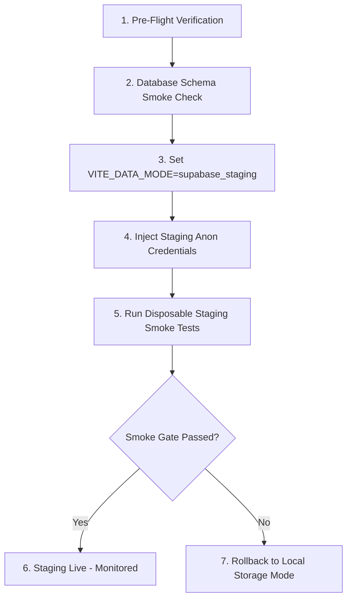

# LARİ — Phase B Supabase Staging Cutover Proposal

**Document ID:** `LARI-DOC-PHASE-B-STAGING-CUTOVER-PROPOSAL-20261024`  
**Status:** `PROPOSAL_ONLY — EXECUTION_STRICTLY_PROHIBITED`  
**Related Issue:** https://github.com/MertSGI/Randapp-main/issues/11  
**Production Blocker Gate:** https://github.com/MertSGI/Randapp-main/issues/10  

---

## 1. Executive Summary & Authorization Boundary

This document outlines the operational and architectural plan for transitioning LARİ's data layer from client-side `localStorage` to the remote Supabase PostgreSQL 17 staging database (`rwedeejhjazwjthdjzrt`).

> [!CAUTION]
> **STRICT EXECUTION BOUNDARY**: This proposal is a source-level planning artifact only. No migrations, DDL, DML, environment secret injection, or remote database cutover may be executed under this instruction. The active development workstream is decoupled from recovery, but live cutover remains strictly gated on resolution of Issue #10.

---

## 2. Prerequisites & Entry Gates

Before any live staging cutover can be scheduled:

1. **Production Recovery Blocker Resolution**:
   - Issue #10 must achieve accepted resolution or formal owner dispensation.
   - Verified exact-SHA quarantine capture must be backed by a verified recovery receipt.

2. **Source Readiness Verification**:
   - `npm run qa:phase-a-functional-acceptance` must PASS (10/10 scenarios).
   - `npm run qa:phase-b-staging-source-readiness` must PASS (7/7 properties).
   - `npm run qa:v1-truthful-client-contracts` must PASS (8/8 contracts).
   - `npm run qa:recovery-hard-gate` must PASS.

3. **Staging Environment Access Verification**:
   - Authenticated owner access to GitHub repository `MertSGI/Randapp-main`.
   - Authorized GitHub Environment `lari-staging-backup`.
   - Verified project identifier: `rwedeejhjazwjthdjzrt`.

---

## 3. Existing Migration Dependencies

The staging database schema represents 54 cumulative migrations:

| Migration Range | Subsystem | Verification Tool |
| :--- | :--- | :--- |
| `01` – `30` | Core Tenants, Users, Services, Staff, Appointments | `scripts/verify-supabase-schema.mjs` |
| `31` – `46` | Policies, KVKK Consents, Multi-Branch, Audit Logs | `scripts/verify-rls-policy-pack.mjs` |
| `47` – `50` | Commercial Packaging, Subscriptions, Plans | `scripts/test-h1e-a-migration-47.mjs` – `50.mjs` |
| `51` – `54` | Dedicated Tenant Isolation & Branch Booking Hardening | `scripts/test-h1e-c-migration-51.mjs` – `54.mjs` |

All migrations are idempotent (`IF NOT EXISTS`, conditional policy creation, safe type assertions).

---

## 4. Cutover Procedure & Environment Configuration

When authorized by a dedicated instruction, the cutover will execute as follows:



### Configuration Variables
```bash
# Canonical data mode selector
VITE_DATA_MODE=supabase_staging

# Staging endpoint (project rwedeejhjazwjthdjzrt)
VITE_SUPABASE_URL=https://rwedeejhjazwjthdjzrt.supabase.co

# Public anonymous key (NEVER service role)
VITE_SUPABASE_ANON_KEY=<staging-anon-key>

# Launch mode selector
VITE_LAUNCH_MODE=unpaid_manual_pilot
```

---

## 5. Security & Row-Level Security (RLS) Isolation

1. **Anonymous Browser Protection**:
   - `VITE_SUPABASE_SERVICE_ROLE_KEY` is strictly prohibited from frontend code and build outputs.
   - Enforced by `npm run check:secrets`.
2. **RPC Security Definer Gate**:
   - Public slot generation uses `get_public_available_slots(p_slug, p_staff_id, p_service_id, p_date)`.
   - Public booking uses `create_public_booking(...)`.
   - Direct anonymous `SELECT * FROM appointments` returns empty array under RLS, preventing tenant data scraping.
3. **Authenticated Operations**:
   - Authenticated salon owners query via session bearer token (`sb-<ref>-auth-token`).
   - RLS policies restrict owner queries strictly to `tenant_id = auth.jwt() -> 'app_metadata' ->> 'tenant_id'`.

---

## 6. Expected Database Side Effects

| Entity | Action | Volume | Retention |
| :--- | :--- | :--- | :--- |
| `tenants` | Initial registration / pilot salon record | 1 row per pilot salon | Indefinite |
| `subscriptions` | Manual provisioning record (`unpaid_manual_pilot`) | 1 row per tenant | Indefinite |
| `services` | Seeded salon catalog items | 5–10 rows per salon | Active |
| `staff` | Seeded staff members | 1–3 rows per salon | Active |
| `availability_rules` | Working hours and staff overrides | 7–14 rows per salon | Active |
| `appointments` | Customer booking records | Variable (1–20 / day) | Indefinite |
| `audit_events` | Immutable operational audit logs | 1 per status change | Append-only |

---

## 7. Rollback & Abort Protocol

If any remote failure occurs during staging activation (e.g. Supabase 500 error, network timeout, migration mismatch):

1. **Immediate Fail-Closed Halt**:
   - The frontend repositories do NOT silently write to mock storage while configured for Supabase mode (verified by Property 3).
2. **Single Variable Reversion**:
   ```bash
   VITE_DATA_MODE=local
   ```
   Rebuilding or re-deploying with `VITE_DATA_MODE=local` immediately restores client-side isolated mock operations without downtime.
3. **Zero Orphaned Data**:
   - Because Supabase repositories fail closed without partial fallback, no split-brain state or orphaned data is created across local and remote stores.

---

## 8. Recommendation & Next Steps

1. Merge PR #9 and stacked Phase A/B review branch after hosted CI qualification.
2. Complete Pilot Salon onboarding in manual local mode (`VITE_DATA_MODE=local`).
3. Maintain Issue #10 as the strict Production release blocker.
4. Schedule staging cutover only after explicit Owner and Controller authorization.
