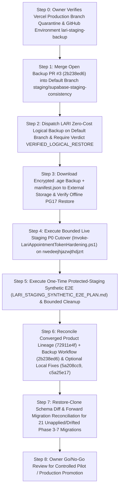

# LARİ — OPEN WORK & DEPENDENCY ORDER (`OPEN_WORK_AND_DEPENDENCIES.md`)

**Verification Timestamp:** `2026-10-21T10:35:00Z`  
**Core Rule:** Only genuinely outstanding operational, database, merge, and verification tasks are listed here. **Zero completed product features from `COMPLETED_WORK_LEDGER.md` are scheduled for redevelopment.**

---

## 1. Dependency Graph Overview

---

## 2. Strictly Ordered Open Work Items

### STEP 0 — Pre-Merge Vercel Production Gate & GitHub Environment Verification (`OWNER_ACTION_REQUIRED`)
- **Why Required:** `staging/supabase-staging-consistency` is both the GitHub default branch and the observed Vercel Production Branch for the Git-linked project. Merging into `staging/supabase-staging-consistency` without first quarantining Vercel Production Branch tracking can trigger an unintended production deployment or alias update.
- **Exact Actions:**
  1. In Vercel (**Project Settings > Environments > Production > Branch Tracking** or **Project Settings > Git**), confirm Production Branch tracking is moved away from `staging/supabase-staging-consistency` to a quarantine branch (or Git is disconnected) so merging PR #3 cannot deploy to production.
  2. In GitHub (**Repository Settings > Environments > `lari-staging-backup`**), confirm:
     - Required reviewers remain disabled (single-owner Option A).
     - Deployment branch restriction allows **only** `staging/supabase-staging-consistency`.
     - Environment variable `LARI_STAGING_POOLER_HOST`, environment secret `LARI_BACKUP_AGE_RECIPIENT` (`age1...` public key whose private identity is stored offline), and repository secret `STAGING_DB_PASSWORD` are set.
     - Account Actions minutes and artifact storage billing are within owner-approved limits.

---

### STEP 1 — Merge Open Backup PR #3 (`2b238ed66c5ef4f47fd35b613f8dda405c85f60d`) (`BLOCKED_ON_STEP_0`)
- **Target PR:** [PR #3](https://github.com/MertSGI/Randapp-main/pull/3) (`review/lari-backup-restore-role-grant-fix-20261020` -> `staging/supabase-staging-consistency`, head `2b238ed66c5ef4f47fd35b613f8dda405c85f60d`).
- **What It Solves:** Fixes the exact PostgreSQL 17 role restoration failure observed in workflow run `39397783444` (`GRANT "supabase_admin" TO "postgres" WITH ADMIN OPTION GRANTED BY "supabase_admin"`) by initializing the disposable container with bootstrap superuser `POSTGRES_USER: supabase_admin` and preparing idempotent `restore-roles.sql` with cycle-checked `ADMIN OPTION` delegation.
- **Already Proven:** Hosted CI run [`39485734117`](https://github.com/MertSGI/Randapp-main/actions/runs/39485734117) (`LARI PG17 Role Restore Qualification`) passed (`SUCCESS`).
- **Action:** Owner merges PR #3 into `staging/supabase-staging-consistency` and verifies the post-merge `LARI QA` check passes.

---

### STEP 2 — Dispatch Live `LARI Zero-Cost Logical Backup` & Verify `VERIFIED_LOGICAL_RESTORE` (`BLOCKED_ON_STEP_1`)
- **Workflow:** `.github/workflows/lari-zero-cost-logical-backup.yml` (`LARI Zero-Cost Logical Backup`)
- **Exact Inputs:**
  - Branch: `staging/supabase-staging-consistency` (at the PR #3 merge commit)
  - `source_project_ref`: `rwedeejhjazwjthdjzrt`
  - `confirmation`: `BACKUP rwedeejhjazwjthdjzrt`
- **Pass Criteria:**
  - Step 6 (`Create encrypted logical backup and verify disposable restore`) succeeds against live `rwedeejhjazwjthdjzrt` and the loopback `postgres:17.6-alpine` service.
  - Step 7 uploads artifact `lari-staging-encrypted-logical-backup-<run_id>-<attempt>` containing `<archive>.age` and `manifest.json`.
  - Step 8 confirms `jq -r '.restore_test.verdict' backup-artifacts/manifest.json` equals **`VERIFIED_LOGICAL_RESTORE`**.

---

### STEP 3 — External Encrypted Retention & Owner Offline Restore Verification (`BLOCKED_ON_STEP_2`)
- **Why Required:** GitHub Actions artifacts expire in 7 days and are not an archival backup.
- **Exact Actions (Owner Operations Card Steps D & E):**
  1. Download `<archive>.age` and `manifest.json` from the successful Step 2 workflow run.
  2. Recompute SHA-256 of `<archive>.age` locally and verify it matches `manifest.json`.
  3. Store `<archive>.age` and `manifest.json` in durable operator-controlled external storage (separate from the offline `lari-staging-backup.agekey` private key).
  4. On an isolated local/disposable PostgreSQL 17 instance (never staging or production), decrypt `<archive>.age` with `age --decrypt --identity lari-staging-backup.agekey`, extract `backup-bundle.tar.gz`, inspect `restore-report.json`, and verify `roles.sql` + `database.dump` restore cleanly.

---

### STEP 4 — Execute Bounded Live Staging P0 Cutover on `rwedeejhjazwjthdjzrt` (`BLOCKED_ON_STEP_3`)
- **Target Migration:** `supabase/migrations/20261011155623_appointment_access_tokens_table_access_hardening.sql`
  - Canonical LF SHA-256: `260F727516CFF4CF0754295206A10E56505A9CA9E22AEC099BB7F21099BD5E13`
  - Windows CRLF SHA-256: `5FCE2EEE8D21A29C68D7685A744234EAC779FB7BB4D92B6E59CBCBD109826970`
- **Procedure:** Follow [`docs/APPOINTMENT_TOKEN_HARDENING_STAGING_CUTOVER.md`](https://github.com/MertSGI/Randapp-main/blob/72911e4fb68dd4f85f7fafef575089104102064e/docs/APPOINTMENT_TOKEN_HARDENING_STAGING_CUTOVER.md) from checkout `72911e4fb68dd4f85f7fafef575089104102064e`:
  1. Set `LARI_STAGING_DATABASE_URL` (pointing to `rwedeejhjazwjthdjzrt` with TLS) and the one-time confirmation variable in operator shell memory.
  2. Run `scripts/Invoke-LariAppointmentTokenHardening.ps1` (which executes `scripts/sql/apply-appointment-token-hardening-staging.sql` in one transaction with `ON_ERROR_STOP`, `lock_timeout = 5s`, `statement_timeout = 60s`).
  3. Record sanitized catalog postcondition booleans:
     - `anon` has zero table privileges (`SELECT, INSERT, UPDATE, DELETE, TRUNCATE, REFERENCES, TRIGGER, MAINTAIN` all `false`) on `public.appointment_access_tokens`.
     - Policy `"Allow public select by token hash"` is absent.
     - Policy `"Owner/Admin manage appointment tokens"` is the sole policy on `public.appointment_access_tokens`.
     - All four `SECURITY DEFINER` manage-token RPCs (`get_public_appointment_by_manage_token`, `cancel_public_appointment_by_manage_token`, `request_public_appointment_reschedule_by_manage_token`, `get_public_pending_reschedule_request_by_manage_token`) remain executable by `anon` and `authenticated`.

---

### STEP 5 — Execute One-Time Protected-Staging Synthetic E2E (Release Gate C4) (`BLOCKED_ON_STEP_4`)
- **Procedure:** Follow [`docs/LARI_STAGING_SYNTHETIC_E2E_PLAN.md`](https://github.com/MertSGI/Randapp-main/blob/72911e4fb68dd4f85f7fafef575089104102064e/docs/LARI_STAGING_SYNTHETIC_E2E_PLAN.md) against protected preview `dpl_GU7az4n1kdrAYBoGLdNhmNAvQCJA` (or the exact preview of `72911e4fb68dd4f85f7fafef575089104102064e`) and staging DB `rwedeejhjazwjthdjzrt`:
  1. Using a synthetic fixture prefix `lari-c4-YYYYMMDDTHHMMSSZ-OWNER_NONCE`, verify discovery -> `create_public_booking` -> `get_public_appointment_by_manage_token` -> cancellation or reschedule request -> owner review -> cross-tenant isolation.
  2. Execute bounded UUID-allowlist cleanup and verify zero remaining synthetic fixture objects.

---

### STEP 6 — Unify Converged Product Lineage (`72911e4f`) with Backup Workflow (`2b238ed6`) & Evaluate 2 Unpushed Local Commits (`CAN_BE_PREPARED_ON_ISOLATED_BRANCH`)
- **Why Required:** Currently, the backup workflow files (`.github/workflows/lari-zero-cost-logical-backup.yml`, `.github/workflows/lari-pg17-role-qualification.yml`, `scripts/run-zero-cost-logical-backup.sh`, `scripts/backup/*`, `docs/LARI_ZERO_COST_BACKUP_RESTORE.md`) live on `staging/supabase-staging-consistency` (`c8dfd3d2...`) + PR #3 (`2b238ed6...`), while the converged product/security/UI-V2/release-gate codebase lives on `staging/ci-lari-release-gate-c1-c4-20261017` (`72911e4fb68dd4f85f7fafef575089104102064e`).
- **Exact Actions:**
  1. On a new integration branch branched from `72911e4fb68dd4f85f7fafef575089104102064e`, port/merge the backup workflow and scripts from `2b238ed66c5ef4f47fd35b613f8dda405c85f60d` so a single branch contains both all 97 product migrations/UI-V2/C1–C4 gates **and** the PG17-qualified zero-cost backup workflow.
  2. Inspect and optionally cherry-pick the two unpushed local product fixes if desired by the owner:
     - `5a208cc9ffad3dfe1200160eea6c054b86c2e2e9` (`fix(discovery): distinguish failed request heading from verified zero results` in `src/pages/DiscoveryMarketplace.tsx`)
     - `c5a25e17691be5bc06bd5af21cb25ffd930c84c7` (`fix(customer-login): replace interactive form with read-only unavailable guidance in supabase mode` in `pages/customer/CustomerLoginPage.tsx`)

---

### STEP 7 — Reconcile the 21 `LOCAL_ONLY` & 4 `REMOTE_ONLY` Phase 3–7 Staging Migrations (`BLOCKED_ON_STEP_3_RESTORED_CLONE`)
- **Procedure:** Using the offline PostgreSQL 17 clone restored in Step 3 and the exact table in [`STAGING_SECURITY_MIGRATIONS_AND_RELEASE.md`](./STAGING_SECURITY_MIGRATIONS_AND_RELEASE.md) (`docs/evidence/migration-reconciliation-20261011.json`):
  1. Resolve the 4 duplicate migration version prefixes (`20260920`, `20260921`, `20260925`, `20260928`) by assigning unique ordered timestamps under controller/owner authority.
  2. Diff the existing remote objects (`customer_segments`, `deactivate_tenant_branch`, `clinic_set_staff_profile`, `clinic_get_my_context`, `evaluate_booking_slot`) and the 4 `wp6_*` remote migrations (`20261008063020`–`20261008063041`) against the restored clone catalog.
  3. Test the reconciled forward migration sequence against the restored clone before requesting owner approval to apply to `rwedeejhjazwjthdjzrt`.
